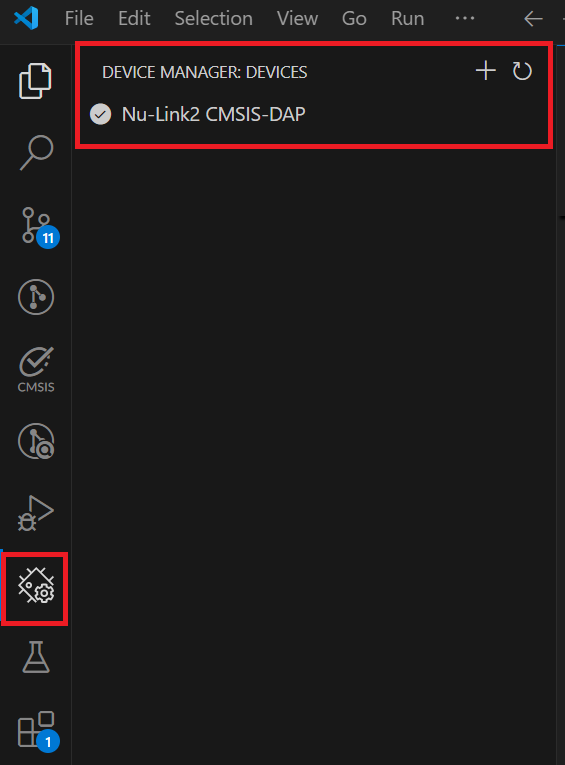

## Before You Start

### Requirements

| Item | Version |
|---|---|
| Visual Studio Code | 1.95.0 or later |
| Supported Debug Probe | **Nu-Link2** (Nu-Link2-Me, Nu-Link2-Pro) or **Nu-Link3** (Nu-Link3-Pro) *(First-generation Nu-Link / Nu-Link-Me / Nu-Link-Pro is not supported)* |
| [Nu-Link USB Driver](https://www.nuvoton.com/resource-download.jsp?tp_GUID=SW1120201207161057&currentFolder=/products/microcontrollers/arm-cortex-m0-mcus/m031-series/) | 1.11 or later |
| Probe firmware | Nu-Link2: 7675r (v3.16) or later; Nu-Link3: 8062r (v3.24) or later |

> **Note:** Make sure your corporate or personal firewall does not block VS Code's network access while the
> extensions are being installed.

### Connecting the Probe

1. Connect a Nu-Link2 or Nu-Link3 debug probe to the PC and the target board.
2. Open Windows **Device Manager** and check that the probe is recognized.

   

       
   

> **Note:** Only one program can use the Nu-Link probe at a time. Close the NuMicro ICP Programming Tool, Keil µVision
> or IAR debug sessions and other debuggers before flashing, debugging or using the CONFIG dialog. A second
> VS Code window can also take over the probe.
