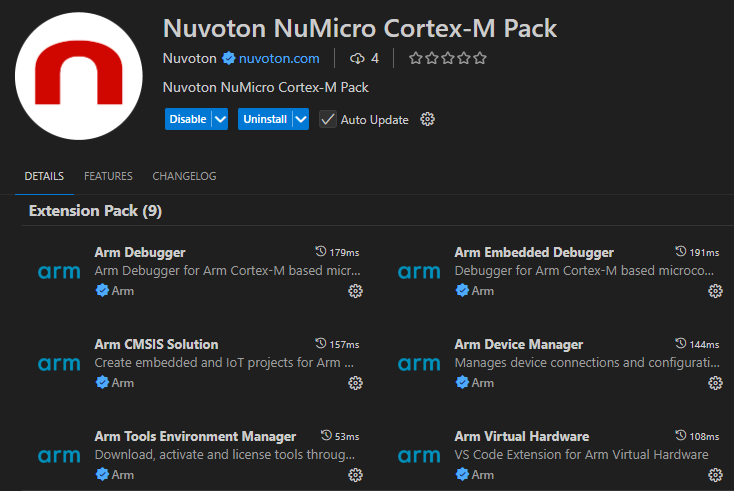

## Installation

1. Open the Extensions view (**Ctrl+Shift+X**).
2. Search for [**Nuvoton NuMicro Cortex-M Pack**](https://marketplace.visualstudio.com/items?itemName=Nuvoton.nuvoton-numicro-cortex-m-pack)
   and click **Install**.

   

       
   

3. Accept the prompts to install the companion extensions, then click **Reload** when asked.

To check the installation, press **Ctrl+Shift+P** and type **Nuvoton:**. The extension's commands are listed.

### What's Included

**Nuvoton NuMicro Cortex-M Pack** is an Extension Pack — installing it installs the extensions below together.
The exact set can change between pack versions; open the Extensions view and expand the pack's **Extension Pack**
section for the list actually installed on your machine.

| Extension | What it's for |
|---|---|
| **Arm CMSIS Solution** | Builds `*.csolution.yml` projects and provides the **CMSIS** view (Manage Solution, Build, Run). |
| **Arm Debugger** | Generates the `CMSIS_DAP@pyOCD` debug configuration used to launch/attach a debug session. |
| **Arm CMSIS Debugger** | The `gdbtarget` debug adapter the CMSIS debug configurations run on. |
| **Debugger for probe-rs** | Flashes the built application (the **Load application** / **Probe-rs Load** task). |
| **Nuvoton NuMicro Development Tools** | Pins the extensions above to fixed versions and adds the probe-rs/pyOCD tasks, CONFIG word dialog, device selection and the other features described in this guide. |
| **Nuvoton NuCodeGen** | AI agents in Copilot Chat that generate NuMicro BSP driver code. For details, see the [Nuvoton NuCodeGen page](https://marketplace.visualstudio.com/items?itemName=Nuvoton.nuvoton-nucodegen). |
| **NuMicro Peripheral Insight** | Peripheral register values while debugging. For details, see the [NuMicro Peripheral Insight page](https://marketplace.visualstudio.com/items?itemName=Nuvoton.vscode-numicro-peripheral-insight). |
| **NuTool - PinView** | Pin functions and pin configuration errors while debugging. For details, see the [NuTool - PinView page](https://marketplace.visualstudio.com/items?itemName=Nuvoton.vscode-nutool-pinview). |
| **NuTool - LCDView** | Segment-LCD design, code generation and live preview. For details, see the [NuTool - LCDView page](https://marketplace.visualstudio.com/items?itemName=Nuvoton.vscode-nutool-lcdview). |
| **NuTool - ClockConfigure** | Clock configuration and code generation. For details, see the [NuTool - ClockConfigure page](https://marketplace.visualstudio.com/items?itemName=Nuvoton.vscode-nutool-clockconfigure). |
| **Nuvoton NuTRM Chatbot** | Answers questions from the Technical Reference Manuals in Copilot Chat. For details, see the [Nuvoton NuTRM Chatbot page](https://marketplace.visualstudio.com/items?itemName=Nuvoton.nuvoton-trm-chatbot). |

> **Note:** **Nuvoton NuMicro Development Tools** keeps some of these extensions at fixed versions. For the pinned extension
> versions and the required CMSIS-Toolbox version, see the
> [Nuvoton NuMicro Development Tools page on the Visual Studio Marketplace](https://marketplace.visualstudio.com/items?itemName=Nuvoton.nuvoton-extension-version-manager).
