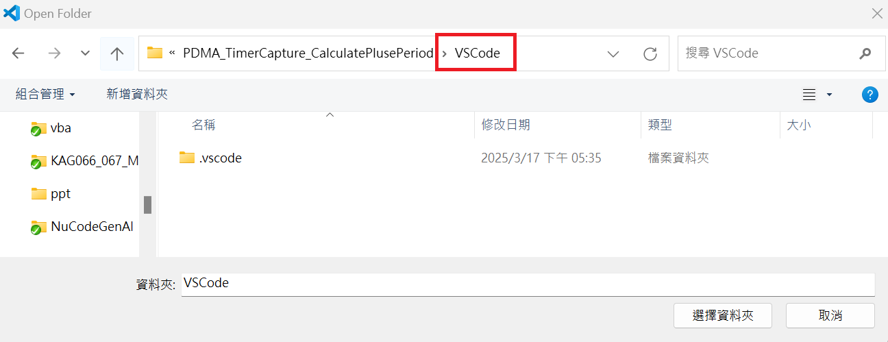

## Opening a Project

1. Download a NuMicro BSP from [OpenNuvoton on GitHub](https://github.com/OpenNuvoton), for example
   [M55M1BSP](https://github.com/OpenNuvoton/M55M1BSP).
2. Use **File > Open Folder...** and select the `VSCode` folder of a sample project, for example
   `SampleCode\Template\Project\VSCode`.

   

       
   

3. Wait until VS Code finishes starting. The extension prepares `.vscode/tasks.json` and `.vscode/launch.json`
   for flashing and debugging automatically.

After this, the following items are available:

| Where | Name | Use |
|---|---|---|
| **Terminal > Run Task...** | **Probe-rs Load** | Flash the application |
| **Run and Debug** view | **CMSIS_DAP@pyOCD (launch)** | Start debugging from reset, stop at `main` |
| **Run and Debug** view | **CMSIS_DAP@pyOCD (attach)** | Attach to the running program without reset |

> **Note:** Do not rename these tasks or debug configurations.

