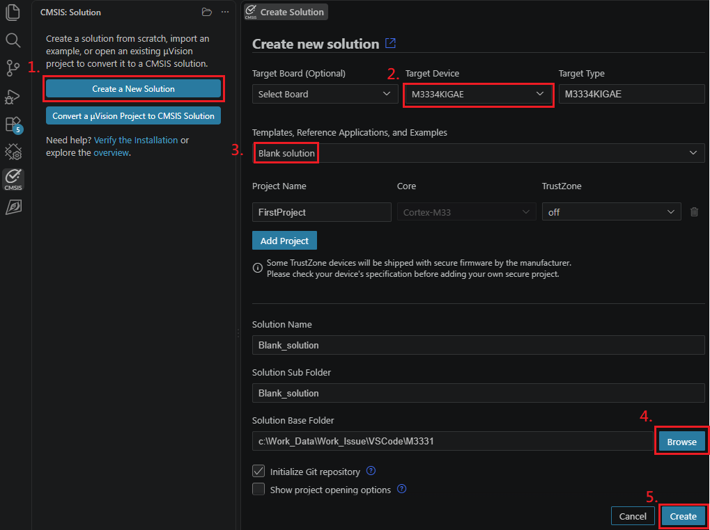
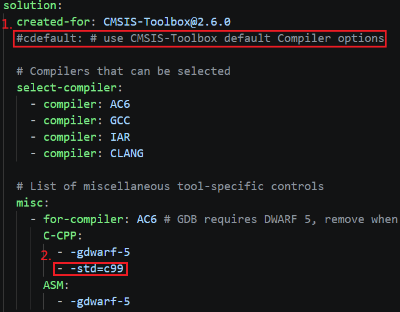
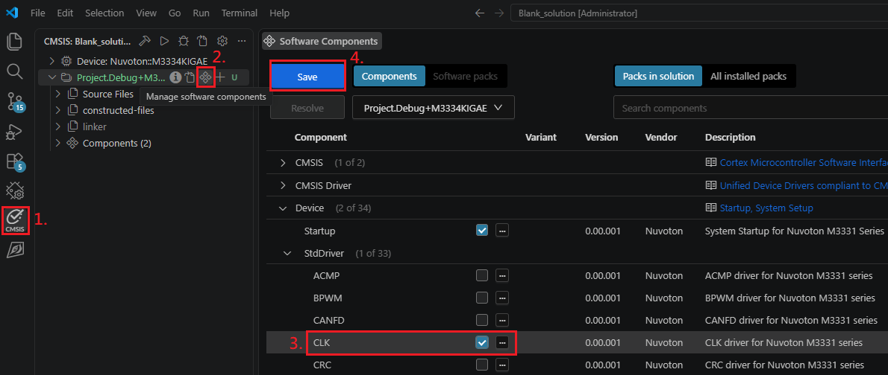
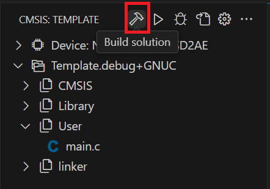

## Creating an Empty Solution

Use this procedure to start a new project from a blank CMSIS solution instead of a BSP sample project.

### Step 1: Create the Solution

1. Click **CMSIS** in the Activity Bar, then click **Create a New Solution**.
2. In **Target Device**, select the NuMicro device, for example `M3334KIGAE`.
3. In **Templates, Reference Applications, and Examples**, select **Blank solution**.
4. Click **Browse** and select the **Solution Base Folder**.
5. Click **Create**.

   <p>
       
   </p>

### Step 2: Modify the Solution Settings

Most Nuvoton BSP projects use the C99 standard, but `cdefault:` applies the CMSIS-Toolbox default compiler
options, which use C11. Switch the solution to C99 as follows.

Open the `<Solution Name>.csolution.yml` file of the new solution, for example `Blank_solution.csolution.yml`,
and make the following changes:

1. Comment out the `cdefault:` line.
2. Under `misc:`, add `- -std=c99` to the `C-CPP:` options of the compiler that the solution uses. The example
   below uses `for-compiler: AC6`.

   ```yaml
   solution:
     created-for: CMSIS-Toolbox@2.6.0
     #cdefault: # use CMSIS-Toolbox default Compiler options

     misc:
       - for-compiler: AC6
         C-CPP:
           - -gdwarf-5
           - -std=c99
   ```

   <p>
       
   </p>

### Step 3: Add Software Components

1. Click **CMSIS** in the Activity Bar.
2. Hover over the project and click **Manage software components**.
3. Select the components that the application needs. For example, under **Device > StdDriver**, select
   **CLK**.
4. Click **Save**.

   <p>
       
   </p>

### Step 4: Build the Project

In the **CMSIS** view, click **Build application** to build the project. You can now start developing your
application.

<p>
    
</p>


