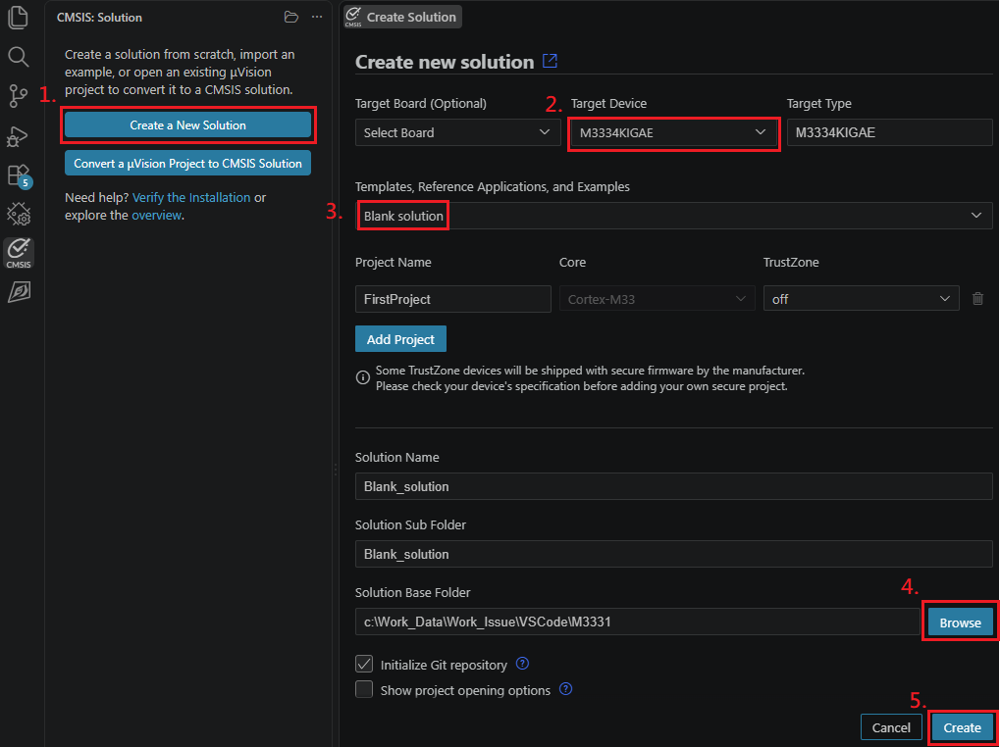
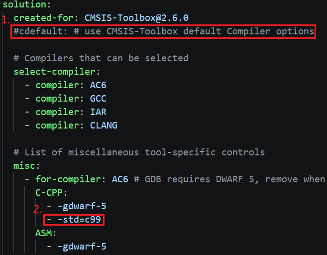
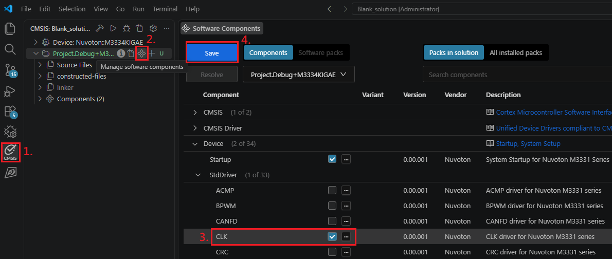
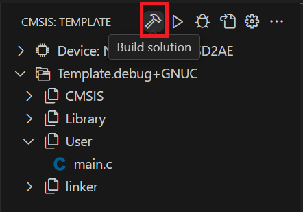

## Creating an Empty Solution

Use this procedure to start a new project from a blank CMSIS solution instead of a BSP sample project.

### Step 1: Install the Nuvoton Device Pack (DFP)

**Create a New Solution** lists only the devices whose Device Family Pack (DFP) is installed. If the NuMicro
device is not in the **Target Device** list, install its DFP with `cpackget` from CMSIS-Toolbox first.

1. Select **Terminal > New Terminal** in VS Code.
2. Update the pack index, then find the DFP name of the device series:

   ```powershell
   cpackget update-index
   cpackget list --public | Select-String Nuvoton
   ```

   The DFP name depends on the CPU core, for example `NuMicroM33_DFP` for `M3334KIGAE`.

3. Install the DFP:

   ```powershell
   cpackget add Nuvoton::NuMicroM33_DFP
   ```

   To install a downloaded `.pack` file instead, run `cpackget add <path>\Nuvoton.NuMicroM33_DFP.<version>.pack`.

4. Check that the DFP is installed:

   ```powershell
   cpackget list | Select-String Nuvoton
   ```

   The pack is installed in `%LOCALAPPDATA%\Arm\Packs\Nuvoton\<DFP>\<version>`.

> **Note:** If `cpackget` is not recognized, the CMSIS-Toolbox environment is not active in the terminal. Run the
> command from the `bin` folder of the installed CMSIS-Toolbox, or add that folder to `PATH`.

### Step 2: Create the Solution

1. Click **CMSIS** in the Activity Bar, then click **Create a New Solution**.
2. In **Target Device**, select the NuMicro device, for example `M3334KIGAE`.
3. In **Templates, Reference Applications, and Examples**, select **Blank solution**.
4. Click **Browse** and select the **Solution Base Folder**.
5. Click **Create**.

   <p>
       
   </p>

### Step 3: Modify the Solution Settings

Most Nuvoton BSP projects use the C99 standard, but `cdefault:` applies the CMSIS-Toolbox default compiler
options, which use C11. Switch the solution to C99 as follows.

Open the `<Solution Name>.csolution.yml` file of the new solution, for example `Blank_solution.csolution.yml`,
and make the following changes:

1. Comment out the `cdefault:` line.
2. Under `misc:`, add `- -std=c99` to the `C-CPP:` options of the compiler that the solution uses. The example
   below uses `for-compiler: AC6`.

   ```yaml
   solution:
     created-for: CMSIS-Toolbox@2.6.0
     #cdefault: # use CMSIS-Toolbox default Compiler options

     misc:
       - for-compiler: AC6
         C-CPP:
           - -gdwarf-5
           - -std=c99
   ```

   <p>
       
   </p>

### Step 4: Add Software Components

1. Click **CMSIS** in the Activity Bar.
2. Hover over the project and click **Manage software components**.
3. Select the components that the application needs. For example, under **Device > StdDriver**, select
   **CLK**.
4. Click **Save**.

   <p>
       
   </p>

### Step 5: Build the Project

In the **CMSIS** view, click **Build application** to build the project. You can now start developing your
application.

<p>
    
</p>


