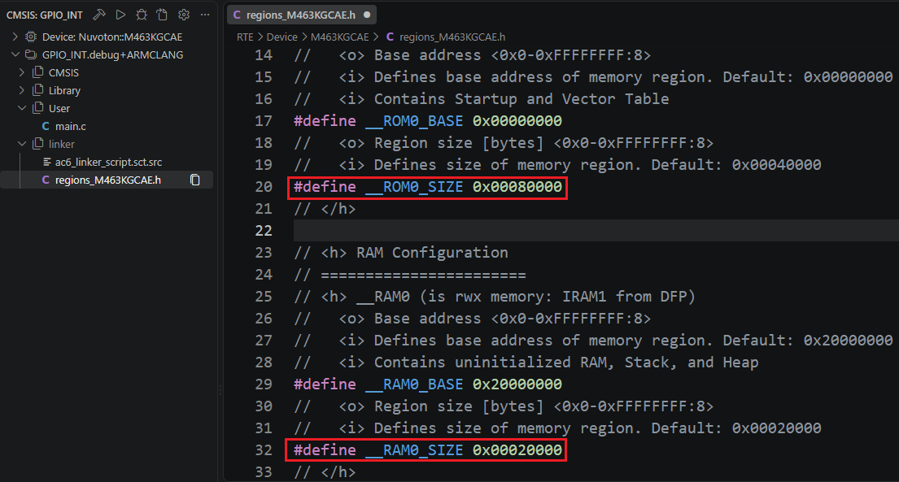
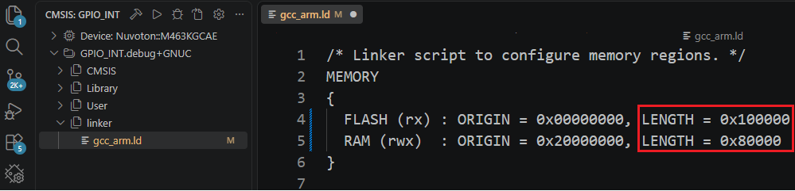

## Selecting the Device

### Change the Device

1. Press **Ctrl+Shift+P** and run **Nuvoton: Select Device Model**.
2. Pick the part number from the list.

The project and the linker script memory sizes are updated for the new device.

### Device Missing from the List

After installing a newer Nuvoton Device Family Pack (DFP), run **Nuvoton: Regenerate chip description**, then
run **Nuvoton: Select Device Model** again.

### Checking ROM and RAM Sizes

ROM and RAM sizes in the linker files are updated automatically. You can check them in the
**linker** folder of the **CMSIS** view.

**Arm Compiler 6 (AC6):** open `regions_<device>.h` and check `__ROM0_SIZE` and `__RAM0_SIZE`.

    

**GCC (GNUC):** open `gcc_arm.ld` and check `LENGTH` of `FLASH` and `RAM`.

    

