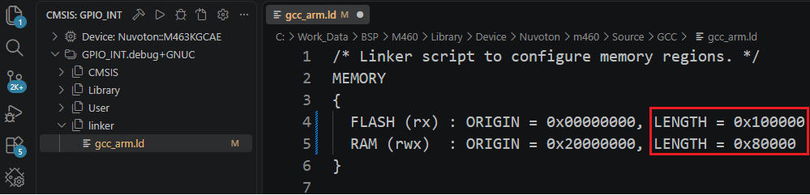

## Selecting the Device

### Change the Device

1. Press **Ctrl+Shift+P** and run **Nuvoton: Select Device Model**.
2. Pick the part number from the list.

The project and the linker script memory sizes are updated for the new device.

### Device Missing from the List

After installing a newer Nuvoton Device Family Pack (DFP), run **Nuvoton: Regenerate chip description**, then
run **Nuvoton: Select Device Model** again.

### Linker Script Memory Sync

The linker script memory sizes are updated automatically when you change the device with
**Nuvoton: Select Device Model**.

To update them manually, run **Nuvoton: Sync linker script memory sizes from cbuild-run**.

    

