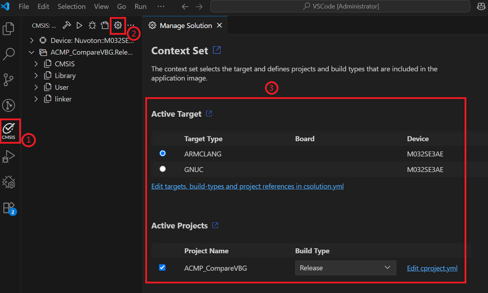
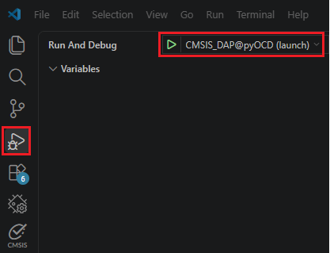

## CMSIS Solution Settings

The BSP sample projects are already configured. Check these settings only if **Load application** or
**Debug application** in the **CMSIS** view does not use the Nuvoton configurations.

1. Click **CMSIS** in the Activity Bar, then click **Manage Solution**.
2. Select the target and project context of the solution.
   

       
   

3. Under **Run & Debug**, set **Debug Configuration** to **CMSIS_DAP@pyOCD (launch)**.
   

       
   
