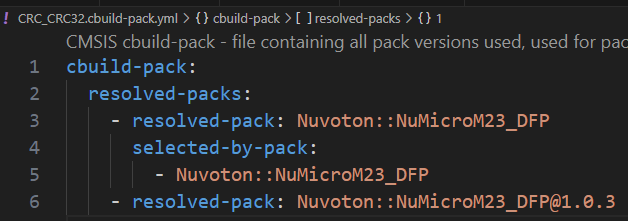
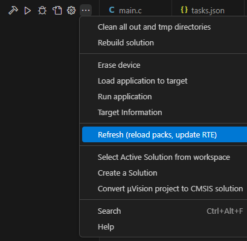

## Updating the Device Pack

The Nuvoton device pack (DFP) defines the flash and SRAM regions, flash algorithms and SVD files of each
device. Update it when a newer pack is released or when flashing reports a region that is not writable.

1. Open `cbuild-pack.yml` in the project folder and change the pack version to the latest one.

   

       
   

2. Click **Refresh** in the **CMSIS** view to reload the pack, then rebuild the solution.

   

       
   

