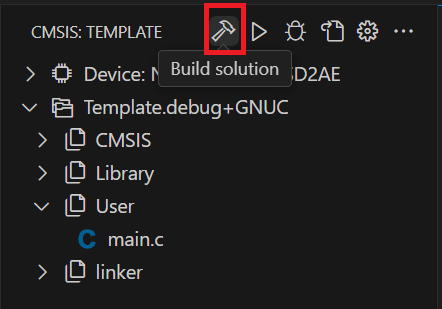

## Building

Build the project with **CMSIS: Build** as usual, or click the **Build** button in the **CMSIS** view. No extra
step is needed.

    

> **Note:** If the build reports that CMSIS-Toolbox cannot be found, see the **Troubleshooting** section.
