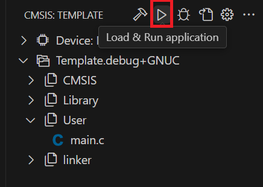

## Flashing the Application

1. Build the project.
2. Click **Load application** (the **Run** button) in the **CMSIS** view, or run
   **Terminal > Run Task... > Probe-rs Load**. Both flash the application with probe-rs.

   

       
   

3. Watch the progress in the terminal panel.
