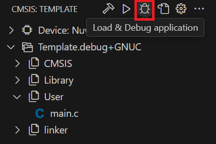

## Starting a Debug Session

1. Flash the application to the target.
2. Open the **Run and Debug** view (**Ctrl+Shift+D**) and select a configuration:
   - **CMSIS_DAP@pyOCD (launch):** resets the target and stops at `main`.
   - **CMSIS_DAP@pyOCD (attach):** attaches to the running program without reset.
3. Click **Debug application** in the **CMSIS** view or press **F5**.

   

       
   

To end debugging, stop the debug session. Nothing else needs to be closed.

> **Note:** If a project built with Arm Compiler 6 does not stop at `main`, see the **Troubleshooting** section.
