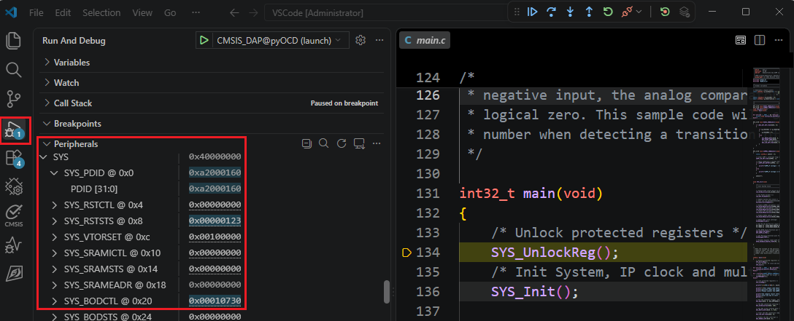

## Peripheral Register View (SVD)

The SVD (System View Description) file describes the peripheral registers of the device. The debugger uses it
to show the registers by name.

To use the device's SVD file in a debug configuration, set:

```jsonc
"svdFile": "${command:nuvoton-debug.getSvdPath}"
```

After a debug session starts, open the **Run and Debug** view and expand **Peripherals**. The peripheral
registers are listed by name with their addresses and current values:

<p>
    
</p>

### Where the SVD File Is

The SVD file is part of the Nuvoton device pack (DFP):

```text
%LOCALAPPDATA%\Arm\Packs\Nuvoton\<DFP>\<version>\SVD\Nuvoton\<file>.svd
```

For example, the SVD file of M487JIDAE in NuMicroM4_DFP 1.0.3 is:

```text
%LOCALAPPDATA%\Arm\Packs\Nuvoton\NuMicroM4_DFP\1.0.3\SVD\Nuvoton\M481_v1.svd
```
