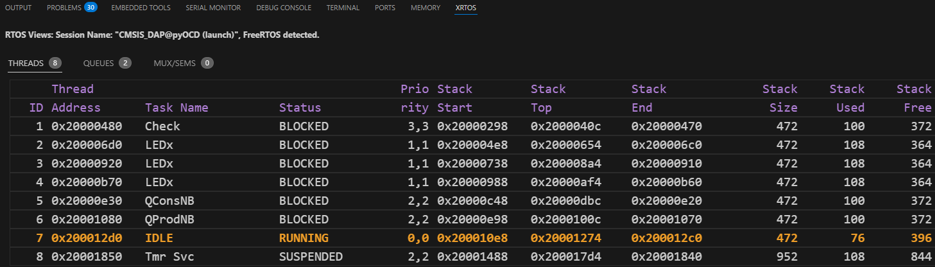

## RTOS View

The **RTOS** view shows the status of each FreeRTOS task while debugging. The project must keep the FreeRTOS
symbols that the debugger reads.

### 1. Keep the FreeRTOS Sections in the Linker Script

In `gcc_arm.ld`, add the following to the `.data` and `.bss` sections:

```ld
KEEP(*(.freertos_tasks))
KEEP(*(.freertos_globals))
```

### 2. Enable the Trace Options in `FreeRTOSConfig.h`

```c
#define configUSE_TRACE_FACILITY                1
#define configUSE_STATS_FORMATTING_FUNCTIONS    1
#define configRECORD_STACK_HIGH_ADDRESS         1
#define INCLUDE_vTaskList                       1
#define INCLUDE_uxTaskGetStackHighWaterMark     1
```

| Option | Purpose |
|---|---|
| `configUSE_TRACE_FACILITY` | Enables the trace facility needed to show thread and task status. |
| `configUSE_STATS_FORMATTING_FUNCTIONS` | Enables the formatted statistics functions, for example `uxTaskGetSystemState()`. |
| `configRECORD_STACK_HIGH_ADDRESS` | Records the stack end address of each task. |
| `INCLUDE_vTaskList` | Enables `vTaskList()`, which lists the status of all tasks. |
| `INCLUDE_uxTaskGetStackHighWaterMark` | Enables `uxTaskGetStackHighWaterMark()`, which returns the stack high-water mark of each task. |

To show run-time statistics as well, also set the following and implement the two macros with a timer or counter:

```c
#define configGENERATE_RUN_TIME_STATS               1
#define portCONFIGURE_TIMER_FOR_RUN_TIME_STATS()    /* Initialize the timer/counter */
#define portGET_RUN_TIME_COUNTER_VALUE()            /* Read the timer/counter */
```

Leave `configGENERATE_RUN_TIME_STATS` at `0` if run-time statistics are not needed.

### 3. Add `uxTopUsedPriority` to `main`

```c
static volatile int uxTopUsedPriority;
uxTopUsedPriority = configMAX_PRIORITIES - 1;
```

### 4. Start Debugging

Start a debug session. The task status is shown in the **RTOS** view.

<p>
    
</p>
