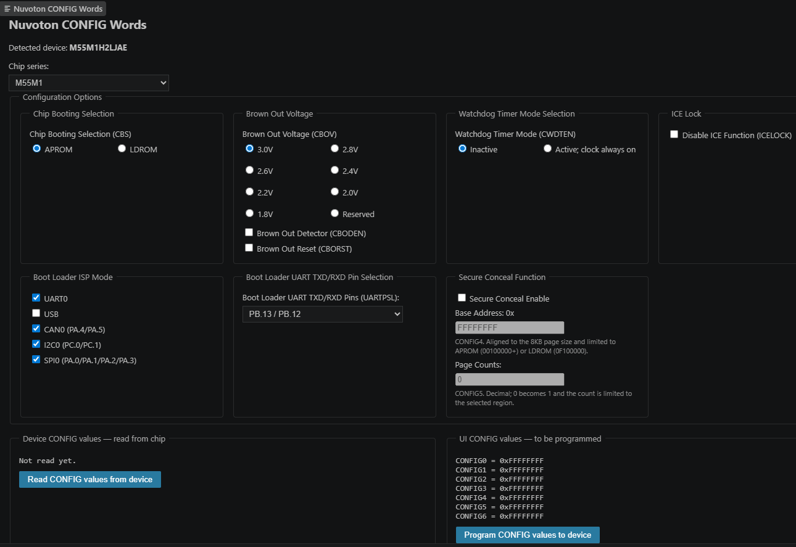

## CONFIG Words

This section describes how to read and program the User Configuration (CONFIG) words of the chip.

### Configure CONFIG Words Dialog

#### Open the Dialog

1. Connect the Nu-Link2 or Nu-Link3 probe and power the board.
2. Stop any debug session and close the NuMicro ICP Programming Tool.
3. Press **Ctrl+Shift+P** and run **Nuvoton: Configure CONFIG Words**.

    

| Area | Description |
|---|---|
| **Detected device** | Part number of the current project. |
| **Chip series** | Selected automatically. Other series can be selected for preview only. |
| **Configuration Options** | All CONFIG settings of the series. |
| **Device CONFIG values — read from chip** | Values read from the chip. |
| **UI CONFIG values — to be programmed** | Values that will be written, built from the form. |

#### Read CONFIG

Click **Read CONFIG values from device**. The values are shown as `CONFIG0 = 0x...`, `CONFIG1 = 0x...` and so
on. Reading does not change the chip.

#### Program CONFIG

1. Set the options in **Configuration Options** and check **UI CONFIG values**.
2. Click **Program CONFIG values to device**.
3. Check the values and warnings in the confirmation dialog, then click **Program**.
4. The chip resets with the new settings. Click **Read CONFIG values from device** to confirm.

> **Note:** Check **High-Risk Settings** before programming.

### High-Risk Settings

| Setting | Result |
|---|---|
| **Disable ICE Function** | Debugging, flashing and CONFIG access through Nu-Link no longer work. |
| **Security Lock** | Flash can no longer be read or downloaded by the debugger. |
| **Advance Security Lock** other than `5A` | Debugging and flashing no longer work. |

> **Warning:** These settings cannot be undone from VS Code. Use **Chip Erase** in the NuMicro ICP Programming
> Tool to unlock the chip.
