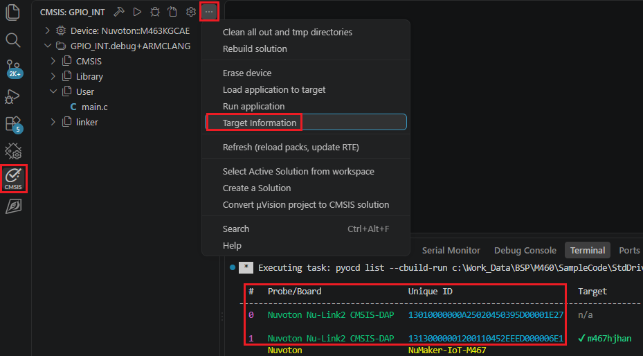
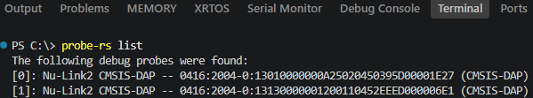
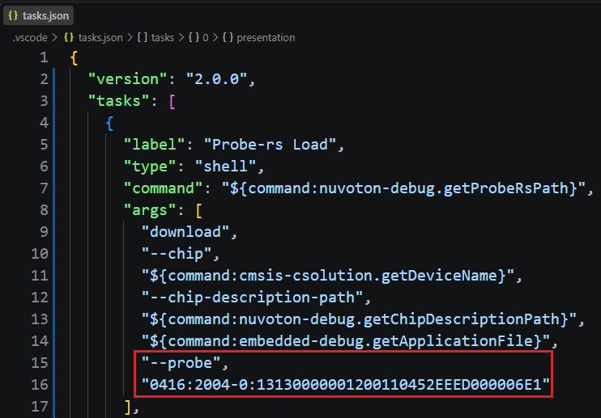
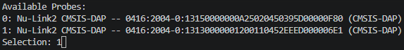
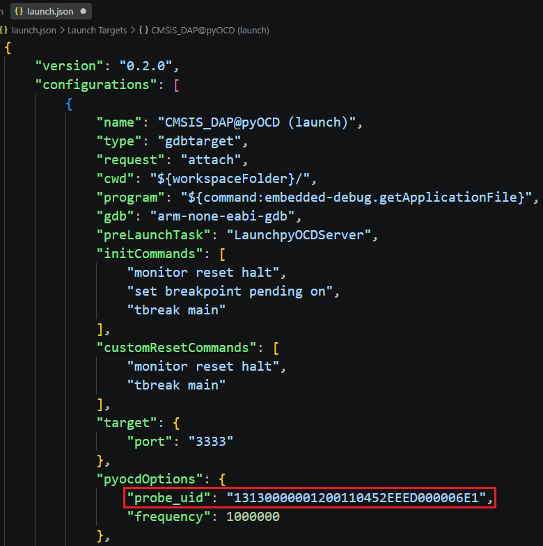

## Debugging Multiple Devices

When several CMSIS-DAP probes are connected, specify which probe to use for flashing and debugging so the extension
targets the correct board.

### Finding a Probe's UID

- In the **CMSIS** view, select **Target Information** to show the UID of each connected CMSIS-DAP device.

  

- Or run `probe-rs list` in a terminal to list the UID of each connected device.

  

### Selecting a Probe for Flashing

Before loading code to the target, edit the **Probe-rs Load** task in `.vscode/tasks.json` and add the desired device
UID. Then click **Load application** — pyOCD will use the device with that UID to load the target.

If you already know the probe's index instead of its UID, you can skip editing `tasks.json`: click **Load application**
and enter the probe index when prompted.

### Selecting a Probe for Debugging

Append the UID after the `probe_uid:` prefix in `pyocdOptions` of `.vscode/launch.json`, save, then click
**Debug application**.

