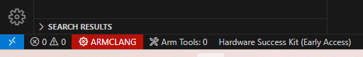
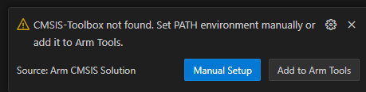

## Setup and Build

### Probe-rs Load or Debug Configurations Are Missing

- Make sure the project folder contains `.vscode/launch.json`, `.vscode/tasks.json` and a `*.csolution.yml` for a
  Nuvoton device.
- Run **Nuvoton: Update workspace tasks.json for probe-rs**.

### CMSIS-Toolbox Cannot Be Found

The project has no `vcpkg-configuration.json`. Click **Add to Arm Tools** to create it. While connected to the
Internet, VS Code downloads and installs the Arm tools listed in it.

    

    

