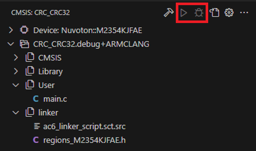
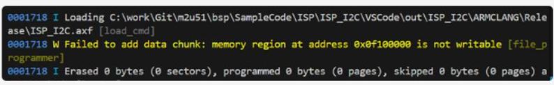

## Flashing

### Load Application and Debug Application Buttons Are Disabled

    

- Set the CMSIS-Toolbox version in `vcpkg-configuration.json` to the version listed on the
  [Nuvoton NuMicro Development Tools](https://marketplace.visualstudio.com/items?itemName=Nuvoton.nuvoton-extension-version-manager)
  page, then reactivate the environment. This regenerates `launch.json` and `tasks.json`.
- In the **CMSIS** view, click **Manage Solution** and check that **Debug Configuration** under **Run & Debug** is
  set to **CMSIS_DAP@pyOCD (launch)**.

### "Connecting to the chip was unsuccessful"

- Run **Nuvoton: Update workspace tasks.json for probe-rs**, then flash again.
- Check the board power and the SWD cable.

### "Memory region at address is not writable"

    

- Update the device pack to the latest version.
- Check that the region to be programmed is defined in the `.cbuild-run.yml` file.
- Make sure the connected device matches the device in `*.csolution.yml`. The device determines the flash and
  SRAM sizes.

### "Failed to resolve current chip description"

- Make sure the Nuvoton DFP used by the project is installed.
- Run **Nuvoton: Regenerate chip description**.
