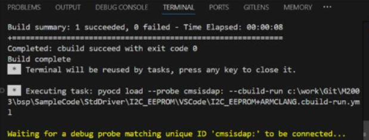

## Probe Connection

### No CMSIS-DAP Probe Found / Waiting for a Debug Probe

This also covers the message "The selected USB device could not be opened".

    

- Make sure you are using a **Nu-Link2** or **Nu-Link3** probe. First-generation Nu-Link probes (Nu-Link, Nu-Link-Me, Nu-Link-Pro) do **not** support the CMSIS-DAP protocol and cannot be used with VS Code.
- Install the latest Nu-Link USB Driver and ensure the probe firmware is up to date.
- Check that the probe is connected and listed in **Device Manager**, and that its CMSIS-DAP option is enabled.
- Close the NuMicro ICP Programming Tool, Keil µVision, IAR and any other debug session, then try again.
- Another VS Code window may have taken over the probe. Close all VS Code windows and restart VS Code.
- Reconnect the Nu-Link2 / Nu-Link3 USB cable.
