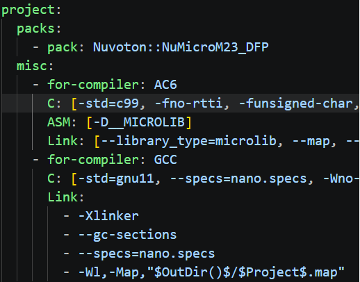

## Debugging

### Debugging Does Not Start

- Flash the application first.
- If several probes are connected, set `probe_uid` in `pyocdOptions` of `.vscode/launch.json`.
- If the connection is unstable, lower `frequency` in `pyocdOptions`, for example to `500000`.

### Debugging Does Not Stop at main

With Arm Compiler 6, optimization can inline `main`. Add the `-fno-inline` build option in `cproject.yml`. This is
not needed for GCC.

    

