## Zephyr Projects

Use **Zephyr IDE** together with the **Nuvoton NuMicro Cortex-M Pack** to set up, build, flash and debug a Zephyr project for NuMicro devices.

### Setup Guide

1. Install the required extension packs:
   - **Nuvoton NuMicro Cortex-M Pack**
   - **Zephyr IDE Extension Pack**

   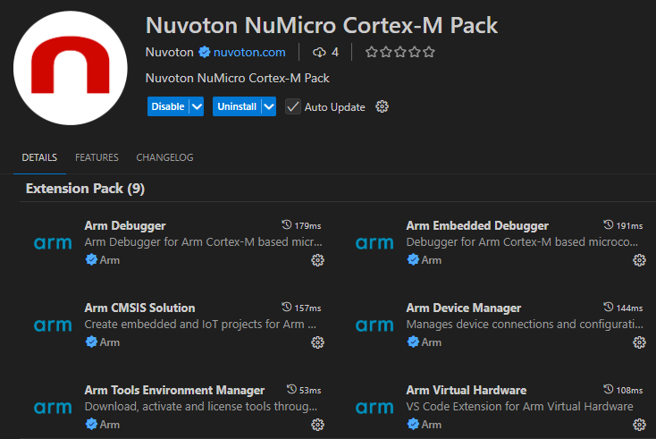
   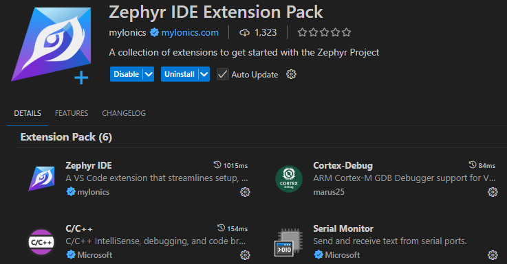

2. Select **Host Tools** and install the required development tools:

   1. Under **Package Manager Status**, check that **winget** shows **Available**. If it does not, see
      [Problems Installing the winget Tool](#problems-installing-the-winget-tool).

      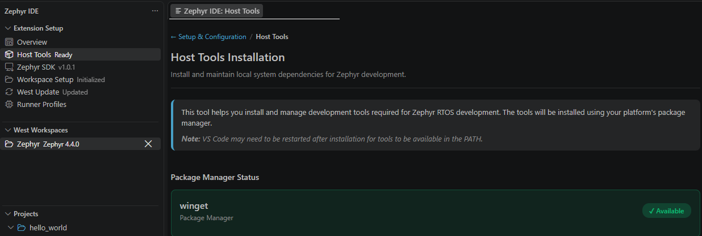

   2. Click **Install All Missing Packages**, then click **Refresh Status** and check that all packages show
      **Installed**. Restart VS Code if a tool is still not found.

      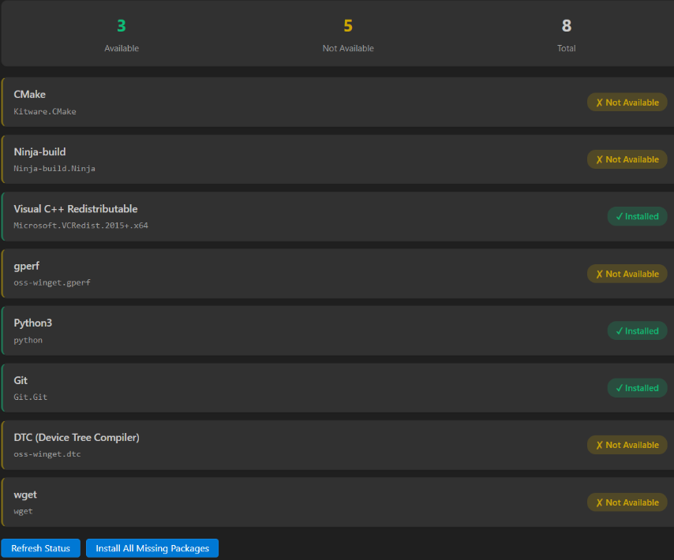

   If a package fails to install, see [Problems Installing Related Packages](#problems-installing-related-packages).

3. Select **Zephyr SDK** and click **Install / Update**.

   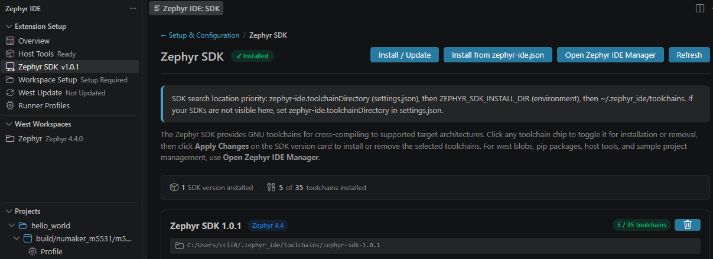

   Select the SDK version that matches the Zephyr version you will use in step 4, for example **1.0.1** for
   Zephyr 4.4.0.

   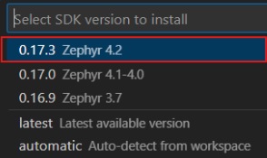

   Select **Select Specific Toolchains**, then select **arm-zephyr-eabi**. This is the only toolchain needed for
   NuMicro Cortex-M devices, so you do not need to install all toolchains.

   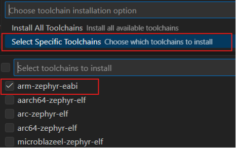

4. Under **West Workspaces**, click **+** (**Create New West Workspace**).

   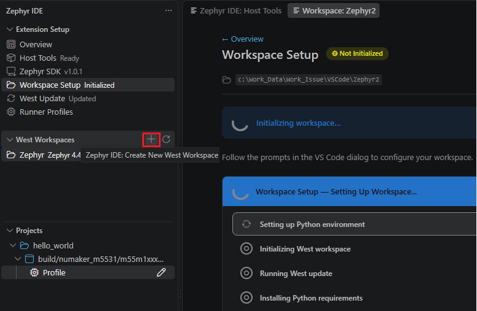

   Select **Full Zephyr** as the workspace template.

   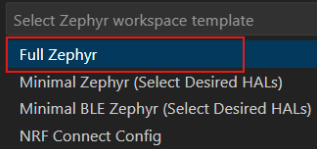

   Select the Zephyr version, for example **v4.4.0**. It must match the SDK version installed in step 3. Wait while
   the Zephyr project files and configuration are downloaded and the workspace is created.

5. Create a Zephyr project from sample code by selecting a project template provided by the Zephyr IDE.

   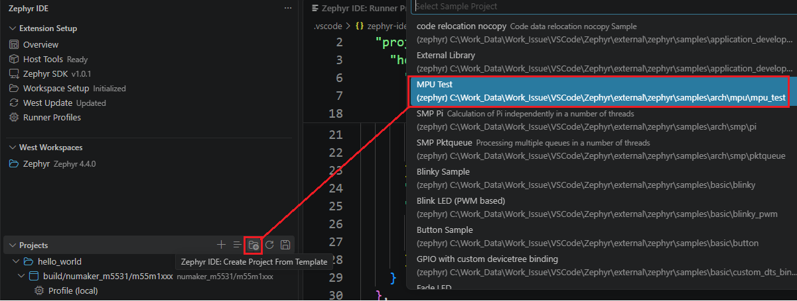

6. Add a build configuration and select your target board, for example `NuMaker-PFM-M467`.

   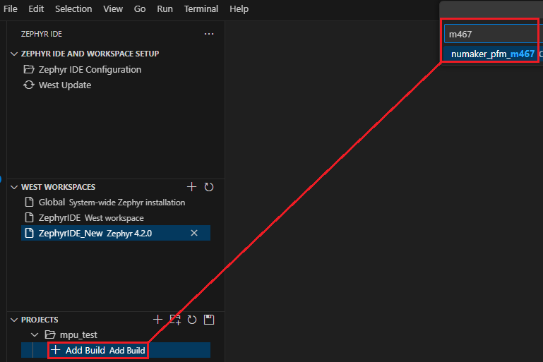

7. Add runner profiles and configure the project runner to use pyOCD.

   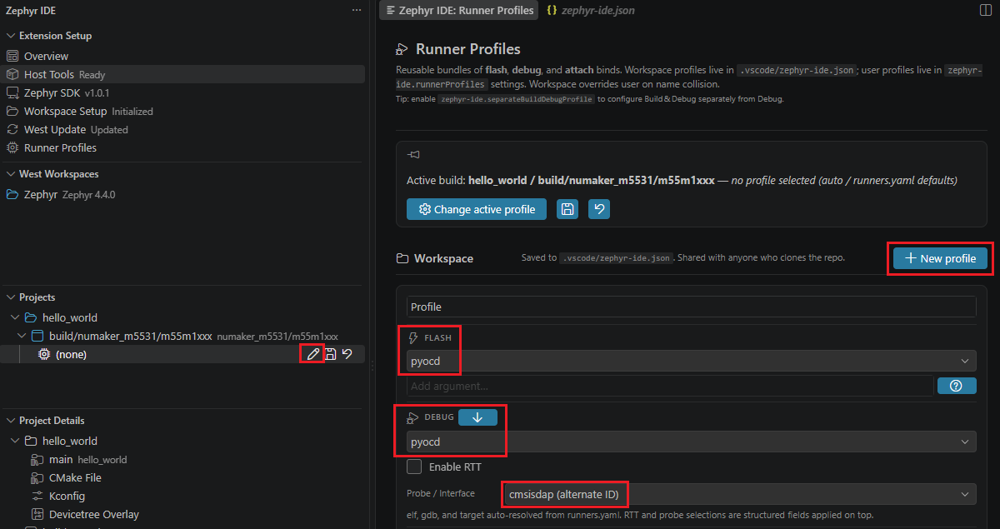

8. Click the build button to build and flash the firmware to your target board, then start a debug session.

   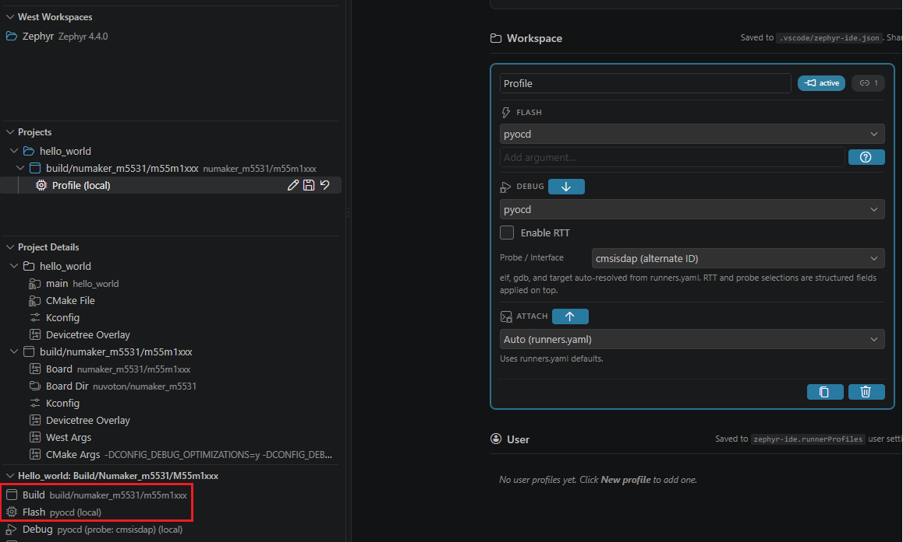

### Troubleshooting

#### Problems Installing the winget Tool

1. From the [winget-cli releases page](https://github.com/microsoft/winget-cli/releases), download:
   - `DesktopAppInstaller_Dependencies.zip`
   - `Microsoft.DesktopAppInstaller_8wekyb3d8bbwe.msixbundle`

   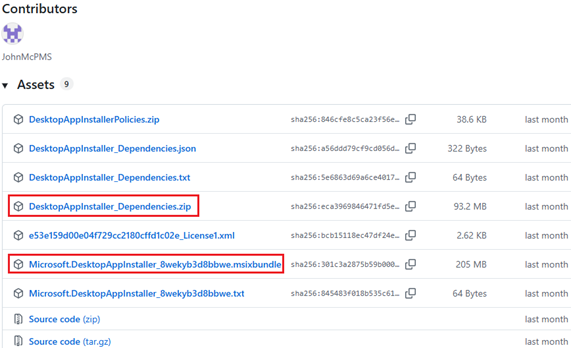

2. Unzip `DesktopAppInstaller_Dependencies.zip`, open PowerShell in its `x64` folder and install the dependencies
   for the winget version you downloaded:

   winget v1.12:
   ```powershell
   Add-AppPackage -Path .\Microsoft.VCLibs.140.00.UWPDesktop_14.0.33728.0_x64.appx
   Add-AppPackage -Path .\Microsoft.VCLibs.140.00_14.0.33519.0_x64.appx
   Add-AppPackage -Path .\Microsoft.WindowsAppRuntime.1.8_8000.616.304.0_x64.appx
   ```

   winget v1.11:
   ```powershell
   Add-AppPackage -Path .\Microsoft.VCLibs.140.00.UWPDesktop_14.0.33728.0_x64.appx
   Add-AppPackage -Path .\Microsoft.UI.Xaml.2.8_8.2310.30001.0_x64.appx
   ```

3. Install winget from the folder that contains the `.msixbundle` file:

   ```powershell
   Add-AppPackage -Path .\Microsoft.DesktopAppInstaller_8wekyb3d8bbwe.msixbundle
   ```

4. Restart VS Code and check that **winget** shows **Available** in **Host Tools**.

#### Problems Installing Related Packages

If installation fails with a red error, open the **OUTPUT** panel and select **Zephyr IDE**.

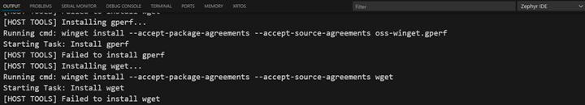

If `gperf` or `wget` fails to install, install it manually from the terminal (replace the package name for other tools
that fail):
```powershell
winget install --accept-package-agreements --accept-source-agreements gperf --source winget
winget install --accept-package-agreements --accept-source-agreements wget --source winget
```

After installing, click **Refresh Status** in **Host Tools**.
